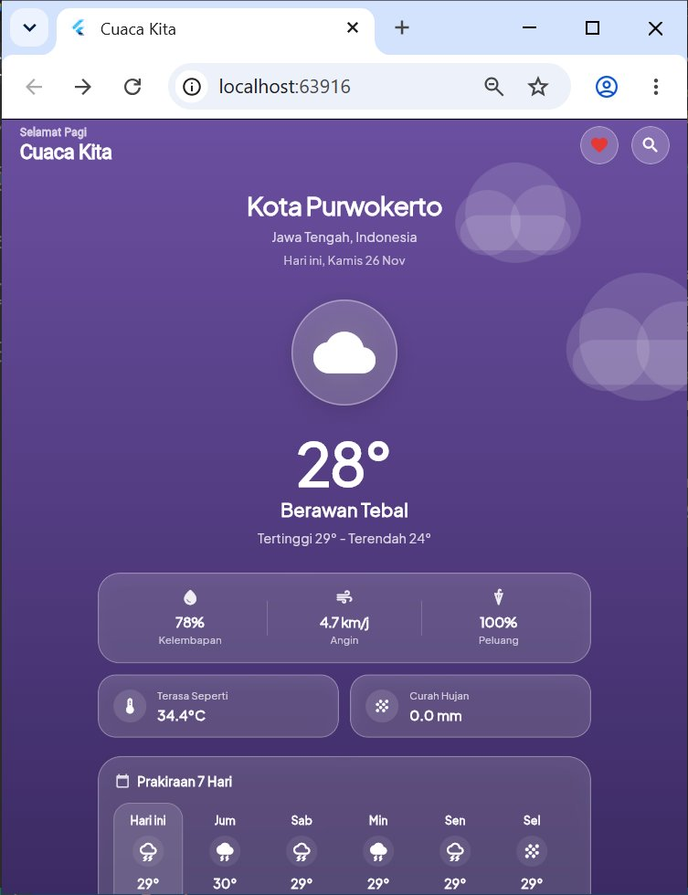
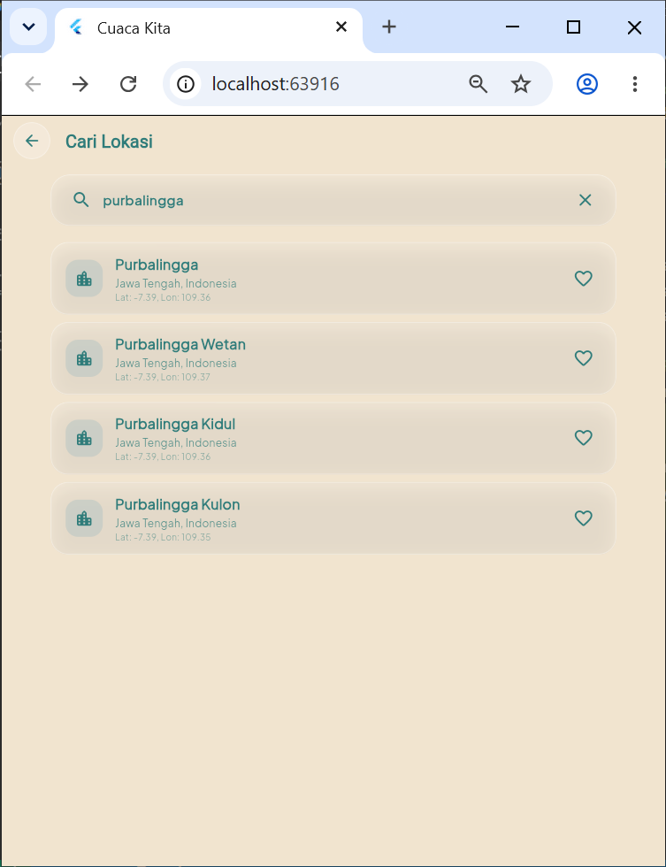

# 🌦️ Cuaca Kita

> Aplikasi prakiraan cuaca modern berbasis **Flutter & Dart** dengan arsitektur **MVVM**, integrasi **Open-Meteo API**, dan desain **Glassmorphism** bergradasi dinamis sesuai kondisi cuaca.

---

##  Tampilan Aplikasi

<div align="center">

| 🏠 Home — Cuaca Utama | 🔍 Search — Cari Lokasi |
|:---:|:---:|
|  |  |
| Gradasi dinamis per kondisi cuaca, ikon besar, suhu besar, strip 7 hari | Pencarian kota real-time dengan debounce, daftar hasil dari Geocoding API |

</div>

---

##  Fitur Utama

### 🏠 Layar Home (Cuaca Utama)
- **Sapaan kontekstual waktu** — *Selamat Pagi / Siang / Sore / Malam*
- **Gradasi latar dinamis** — bertransisi halus (~600 ms) mengikuti kondisi cuaca saat ini
- **Animasi awan mengambang** (`CloudBackground`) di latar belakang; menghormati `disableAnimations`
- **Ikon cuaca besar** (diameter 116 px) di dalam lingkaran kaca berlapis glow
- **Suhu sangat besar** (font 64 px), deskripsi kondisi Indonesia, rentang suhu harian
- **Kartu statistik kaca 3 kolom**: Kelembapan · Kecepatan Angin · Peluang Hujan
- **2 kartu sekunder kaca**: Terasa Seperti & Curah Hujan
- **Strip prakiraan 7 hari** horizontal yang dapat digeser (`DailyForecastStrip`)
- **Pull-to-Refresh** untuk memperbarui cuaca seketika

### 🔍 Layar Search & Favorit
- **Kolom pencarian kaca** dengan mekanisme **Debounce 500 ms**
- **Hasil nyata dari Geocoding API** — nama kota, provinsi, negara, koordinat
- **Kartu lokasi favorit berwarna** memuat cuaca paralel dari API (`Future.wait`)
- **Responsif 2 kolom** pada layar lebar ≥ 600 px (tablet / desktop)
- **Swipe-to-Dismiss** untuk menghapus favorit dengan konfirmasi gestur

###  Persistensi Lokal
- Daftar lokasi favorit disimpan di **SharedPreferences** (format JSON)
- Lokasi terakhir yang dipilih dimuat otomatis saat aplikasi dibuka kembali

###  Aksesibilitas
- Semua tombol aksi dilengkapi `Semantics` label dan `Tooltip`
- Area sentuh minimum 48×48 px pada setiap elemen interaktif

---

##  Desain & Palet Warna

### Palet Sand (Contrast Safe — AA Pass)

| Nama | Hex | Peran |
|---|---|---|
| **Sunlit Ochre** | `#FFD248` | Aksen kuning hangat, indikator cuaca cerah |
| **Ocean Glass** | `#A7BEC1` | Elemen sekunder, latar ikon pencarian |
| **Deep Navy** | `#2F7C7A` | Teks utama, elemen tegas, border |
| **Warm Sand** | `#F1E4CF` | Latar belakang layar Search & default |
| **Spring Meadow** | `#CAFFA6` | Chip peluang hujan & aksen hijau |

### Gradasi Kondisi Cuaca (`WeatherThemeHelper`)

| Kondisi | Gradasi | Kode WMO |
|---|---|---|
| ☀️ Cerah | `#FFC043` → `#F58A07` | 0, 1 |
| ⛅ Berawan | `#6B4FA0` → `#3B2A63` | 2, 3 |
| 🌫️ Berkabut | `#6E8996` → `#475E69` | 45, 48 |
| 🌧️ Hujan / Gerimis | `#3B5B78` → `#223547` | 51–67, 80–82 |
| ❄️ Salju | `#56B4D3` → `#348AC7` | 71–77, 85, 86 |
| ⛈️ Badai Petir | `#453D66` → `#201B36` | 95–99 |

---

##  Tech Stack

| Kategori | Teknologi |
|---|---|
| Framework | Flutter / Dart SDK ^3.13 |
| Arsitektur | MVVM (Model-View-ViewModel) |
| State Management | Provider (`ChangeNotifier`) |
| Networking | `http` — Open-Meteo Geocoding & Forecast API |
| Local Storage | `shared_preferences` |
| Typography | `google_fonts` — Plus Jakarta Sans |
| Utility | `intl` (format tanggal Indonesia) |

---

##  Struktur Proyek

```
lib/
├── main.dart                            # Entry point, MultiProvider setup
├── core/
│   ├── constants/view_state.dart        # Enum ViewState (initial, loading, success, empty, error)
│   ├── exceptions/app_exception.dart    # Exception ramah pengguna
│   ├── theme/
│   │   ├── app_theme.dart               # AppColors + ThemeData terpusat (light & dark)
│   │   └── weather_theme_helper.dart    # Pemetaan WMO code → WeatherPalette (gradasi + ikon)
│   └── utils/
│       ├── greeting_helper.dart         # Sapaan waktu Bahasa Indonesia
│       └── weather_code_helper.dart     # Mapper kode WMO → teks & ikon
├── models/
│   ├── location_model.dart              # Model kota hasil geocoding
│   ├── weather_model.dart               # Model cuaca terkini & prakiraan 7 hari
│   └── favorite_weather.dart            # Model item favorit + cuaca + status loading
├── services/
│   ├── geocoding_service.dart           # Client API Geocoding Open-Meteo
│   ├── weather_service.dart             # Client API Forecast Open-Meteo (timeout 10 s)
│   └── favorite_storage_service.dart    # SharedPreferences — favorit & lokasi terakhir
├── viewmodels/
│   ├── weather_viewmodel.dart           # State layar utama (initialize, selectLocation, refresh)
│   ├── search_viewmodel.dart            # State pencarian kota + debounce 500 ms
│   └── favorite_viewmodel.dart          # State favorit + parallel fetch (Future.wait)
└── views/
    ├── home/weather_screen.dart         # Layar Home — hero layout & gradasi dinamis
    ├── search/search_screen.dart        # Layar Search — hasil geocoding & kartu favorit
    └── widgets/
        ├── cloud_background.dart        # Awan animasi mengambang di latar belakang
        ├── glass_card.dart              # Kartu kaca frosted (Glassmorphism)
        ├── glass_icon_button.dart       # Tombol kaca bulat (48×48 px)
        ├── city_weather_card.dart       # Kartu favorit berwarna per kondisi cuaca
        ├── stat_row.dart                # Statistik 3 kolom + 2 kartu mini
        ├── daily_forecast_strip.dart    # Strip prakiraan 7 hari horizontal
        └── state_widgets.dart           # Loading, Error & Empty state bergaya kaca
```

---

##  Arsitektur MVVM

```
┌──────────────────┐   event   ┌───────────────────────┐   call   ┌────────────────────┐
│   VIEW (Widget)  │ ────────► │  VIEWMODEL             │ ───────► │  SERVICE           │
│                  │           │  (ChangeNotifier)       │          │  (HTTP & Storage)  │
│  context.watch() │ ◄.notify. │  ViewState + notifyListeners │ ◄─── │  fromJson / save   │
└──────────────────┘           └───────────────────────┘          └────────────────────┘
                                                                           │
                                                                    ┌──────▼──────┐
                                                                    │   MODEL     │
                                                                    │   (Dart)    │
                                                                    └─────────────┘
```

**Aturan tegas:**
- **View** → hanya render UI + kirim event ke ViewModel. Tidak ada HTTP atau logika bisnis.
- **ViewModel** → kelola `ViewState`, panggil Service, panggil `notifyListeners()`.
- **Service** → lakukan HTTP GET / SharedPreferences read-write, kembalikan Model.
- **Model** → Dart plain object dengan `fromJson` / `toJson`.

---

##  API Open-Meteo

### A. Geocoding (Cari Kota)
```
GET https://geocoding-api.open-meteo.com/v1/search
    ?name={query}&count=10&language=id&format=json
```
Field: `results[].id`, `name`, `latitude`, `longitude`, `country`, `admin1`

### B. Forecast (Data Cuaca)
```
GET https://api.open-meteo.com/v1/forecast
    ?latitude={lat}&longitude={lon}
    &current=temperature_2m,relative_humidity_2m,apparent_temperature,
             weather_code,wind_speed_10m,precipitation
    &daily=weather_code,temperature_2m_max,temperature_2m_min,
           precipitation_probability_max
    &timezone=auto&forecast_days=7
```

---

##  Cara Menjalankan

```bash
# 1. Clone repositori
git clone https://github.com/deraaml25/ResponsiPemmob.git
cd ResponsiPemmob

# 2. Install dependensi
flutter pub get

# 3. Jalankan di browser (Chrome)
flutter run -d chrome

# 4. Jalankan di Android / emulator
flutter run -d android
```

> **Catatan**: Tidak memerlukan API key — Open-Meteo adalah API cuaca gratis & terbuka.

---

##  Testing

```bash
# Analisis statis (0 issues)
dart analyze

# Unit & widget test
flutter test
```

---

##  Dependensi (`pubspec.yaml`)

```yaml
dependencies:
  flutter:
    sdk: flutter
  provider: ^6.1.2
  http: ^1.2.2
  shared_preferences: ^2.3.2
  google_fonts: ^6.2.1
  intl: ^0.19.0
```

---

<div align="center">

**[Dera Amelia](https://github.com/deraaml25)** · Universitas Jenderal Soedirman

</div>
